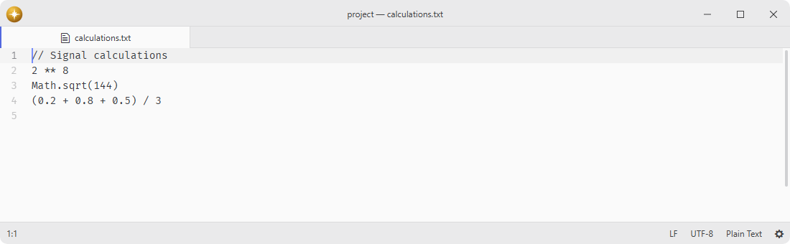
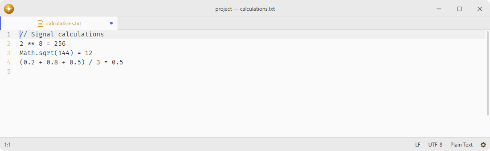

# calc-inline

Evaluate JavaScript expressions and number selections.

Fork of [atom-calc](https://github.com/Lixquid/atom-calc). The current calculator uses a replacement implementation.

Work through calculations directly in a text editor without switching to a separate calculator.

## Features

- **Expression evaluation**: append results to selected JavaScript expressions.
- **In-place replacement**: replace selected expressions with their results.
- **Batch calculation**: evaluate every selected expression in a single undo step.
- **Extended variables**: reuse earlier results with `_`, `_1`, `_2`, and later names.
- **Math shortcuts**: call functions such as `pow` and `max` without a `Math.` prefix.
- **Selection numbering**: replace each selection with its zero-based or configured index.

## Installation

To install `calc-inline` search for it in the Install pane of the Lumine settings, or run the command `lumine --install lumine-code/calc-inline`.

## Commands

Commands available in `lumine-text-editor:not([mini]):not([readonly])`:

- `calc-inline:evaluate`: append each selected expression's result,
- `calc-inline:replace`: replace each selected expression with its result,
- `calc-inline:count`: replace each selection with its index.

## Usage

Calculations are disabled when the editor's grammar is **None**. Select a grammar to enable the commands again.

With no selection, evaluation can process the document one line at a time. Blank lines and lines beginning with `//` are skipped.

Numbering reads immutable range metadata without extracting the selected text. Evaluation and replacement prepare edits in cancellable batches and publish them as one undo operation; editing, moving the selection, changing grammar, starting another calculation or deactivating the package cancels obsolete preparation. Whole-document mode retains CR, LF and CRLF separators and never joins the document into one string.

Each JavaScript expression and its formatted result is limited to 65,536 UTF-16 code units at the VM boundary. Extended variables retain at most 10,000 results per run; disable that option to evaluate more expressions without retaining their numbered values. A budget failure leaves the document unchanged. Ordinary expression errors leave those expressions unchanged and allow later inputs to run; at most 20 individual error notifications are shown, followed by a count of any others.

When extended variables are enabled, `i` is the current selection index, `_` is the previous result, and `_1`, `_2`, and later names retain results from the current run. `Math.pwd(length)` and its `Math.password` alias generate a random printable string; the default length is 20.

Math shortcuts are enabled by default, so `pow(2, 8)` and `Math.pow(2, 8)` both evaluate to `256`.

## Contributing

Got ideas to make this package better, found a bug, or want to help add new features? Just drop your thoughts on GitHub. Any feedback is welcome!
